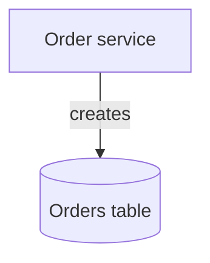

# tldr — Reference

Loaded from `SKILL.md` steps 2–6. Sections: note template, content rules, updating a note, pre-flight.

## Note template

Copy this shape. Leave out any section the PR does not have, except `## Tests` (write "No test changes.") and `## My notes` (always present, always last).

````markdown
---
type: summary
project: <project slug: the _index.md project key, else the folder name>
summary: "<one sentence: what the PR changes and why>"
source: "<PR URL>"
pr: <number>
head_sha: <full head SHA from pr.json>
pr_state: <open | merged | closed>
status: active
updated: <YYYY-MM-DD>
tier: 3
tags:
  - <project>
  - pr-summary
---

# <PR title, exactly as on GitHub>

**Before:** <one line>
**Now:** <one line>

[[<project>]] · <author login> · `<head branch> → <base branch>` · +<additions> −<deletions> in <files> files

<header notes: motivation, open dependency PRs, follow-ups as plans>

## Decisions

- **<the choice>** <(implicit) when the description marks it so>. <why>. Trade-off: <what it costs>.

## Flow



## What changed

### <system part, in the order data moves>

<one line the diff cannot show: a why, a trade-off, a cost>

[`<path>`](https://github.com/<owner>/<repo>/blob/<head_sha>/<path>#L<n>)
```diff
 export function placeOrder(cart: Cart) {
-	validateCart(cart)
+	assertCartHasItems(cart, "an order needs at least one item")
 	// ...
 }
```

## Review threads

> [!question] <author> on `<path>:<line>`
> <comment, shortened>

## Tests

- [added] `<path>:<line>` <test name in words>
- [modified] `<path>:<line>` <test name> · replaces `<path>:<line>`, `<path>:<line>`
- [removed] `<path>:<line>` <test name>

## QA focus

- <risk or gap> · `<path>:<line>`

## My notes

````

## Content rules

### Story order

Header → decisions about the whole PR → flow (only when needed) → use sites (what calls the change, before and after) → contract (types and signatures between moving parts) → one `###` section per system part, producer before consumer, named after the part, not the file → review threads → tests → QA focus → my notes.

### Author's words

The description is written by a human; reuse its words, placed next to the code they explain. tl;dr → Before/Now lines. `[!NOTE]` blocks → callouts beside their topic. Safety or revert claims → above the code that makes them true. Decisions → `## Decisions`, or the top of the section they shape. Linked PRs from `linked-prs.tsv`: an `OPEN` one is a dependency in the header; a `MERGED` one is history, mention it only if the reader needs it. Follow-up work with no PR yet is a plan in the future tense ("A later PR will add …"). QA or manual test steps → `## QA focus`. Drop CI-passed claims and how the work was assigned. You may fix grammar, replace code names with plain words and cut filler; keep the meaning.

### Code

- Show signatures, types and contracts that cross a system boundary; both ends of each contract (where the value is made and where it is read); code on hot paths; the message of each shown `assert` or `throw`; a kept legacy branch (shortened); a removed safety net (try/catch, fallback) on the `-` side.
- Leave out imports and re-exports, input guards (unless the PR is about the guard), implementation the names already describe, internal-only types, test bodies and test helpers.
- A change repeated in many places: show it once, with `// same change in every caller` above it on both sides.
- Code that only moves or is renamed: one sentence, no diff. Code extracted into a new function: show the old function on the `-` side and the result on the `+` side, so the moved lines are unchanged rows. Before calling a function new, search for its body at the merge base (`git show "${base}:<path>"`) and in the removed lines of `full.diff`.
- Shorten with `// ...` for statements and `/* ... */` for expressions. A shortened literal must look shortened: `{ endpoint: /* ... */, siteId }`.
- Keep the enclosing declaration around a snippet, shortened, so the reader knows where it lives.
- Code shown on one side that also exists on the other side goes on both sides as an unchanged row, shortened the same way; else it reads as added or removed.
- Prompts an AI agent reads: show the rendered text as a `diff`, not the code that builds it.

### Diff format

One fenced `diff` block per snippet, with a permalink above it to the head commit line of its first changed row. Each row starts with `+`, `-` or a space, then the repo's own indentation. Code lines stay within 100 columns (a tab counts as 2). Blank lines separate steps on both sides. The budget counts non-blank `+` and `-` rows plus test list items; unchanged rows are free but must earn their place.

### Tests

- A test is **added** when its name is new, **removed** when the PR deletes its name (a `removed` row in `test-changes.tsv`), else **modified**. A test that replaces removed tests (a rename, or one parameterized test for several old ones) is listed as modified with `replaces` naming each old `path:line`.
- List a modified test only when the behavior it checks changes, not when only its setup, data or helpers change.
- Read the full body at the head commit before listing a test. Its listed name must say what its assertions check. When the code name says something no assertion checks, write a name from the assertions, add `(code name: "<name>")`, and report it to the user.
- Parameterized tests (`test.each`, a `for` loop over cases, a template-literal name such as `` `flow for ${network}` ``): list each case's name with its values filled in, indented under the test.
- Tests of one `test.describe` block: indent them under a `- <describe name in words>` line; leave the block name out of each test name.
- Write names in words: drop a `Test` prefix, split camel case, write out abbreviations. A name already in words stays as it is.
- Pass, fail or skip claims come from markers in the code (`test.skip`, `test.fixme`, `test.fail`), never from guessing.

### QA focus

What a tester must look at after reading this PR: a changed contract with no test on one of its ends, an edge case the new tests skip, a removed test whose behavior nothing else checks, a config or migration that needs a manual check. Each item cites `path:line`. Mark an item `(inferred)` when it comes from reading code rather than from a test or the description.

### Flow

Add a `mermaid` flowchart only when the PR adds or changes a link between system parts **and** that link is more than a straight line (branches, a cycle, several parts). Boxes are systems, not functions. Arrow labels are short verbs or the data that moves. Dashed arrows (`-.->`) mark legacy or fallback paths.

### Words

Use few words; let the code show what code can show. Write for an engineer of the same company who does not work on this project. Make the actor the subject ("The server sorts the list", not "The list sorts"). Name things in plain words outside code blocks; add the code name once in backticks only when the reader needs it to find the thing. Explain a project-only term once, with a footnote at its first use (`shadow write[^shadow]`, then `[^shadow]: A write to the new table next to the write to the old one, while data moves.`).

## Updating a note

Run `gather.sh` again into the same scratch folder. Compare the new `headRefOid` with the note's `head_sha`; when they differ, re-read the changed code and re-check every listed test, also tests whose name did not change. Rewrite every section except `## My notes`, which you copy back byte for byte. Set `head_sha`, `pr_state` and `updated`. Keep `status: active`. Keep the filename. When the PR dropped an approach the earlier note showed, keep one line under its section: `Dropped: <approach>, because <reason>.`

## Pre-flight

Check the finished note against each item; fix and re-check before reporting:

1. `check_note.py` exits 0.
2. Every open human review thread from `gather.sh` output is in `## Review threads`, and no AI or bot thread is.
3. Every listed test was read at the head commit, and its name agrees with its assertions.
4. Every `(inferred)` QA item is marked; every other QA item points to a test, the description or a diff.
5. No sentence repeats what a diff right next to it shows.
6. No secret, customer data, wallet address or internal hostname appears; placeholders stand in for each.
7. `## My notes` is unchanged from the previous version (on an update).
